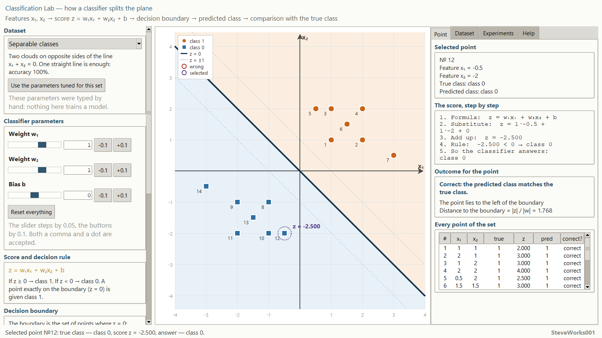
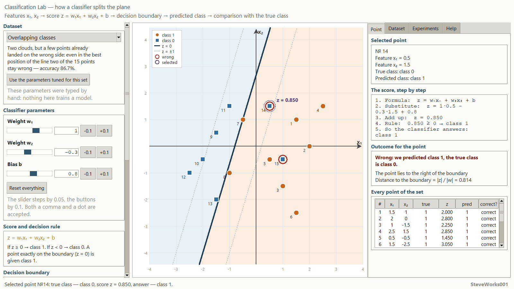
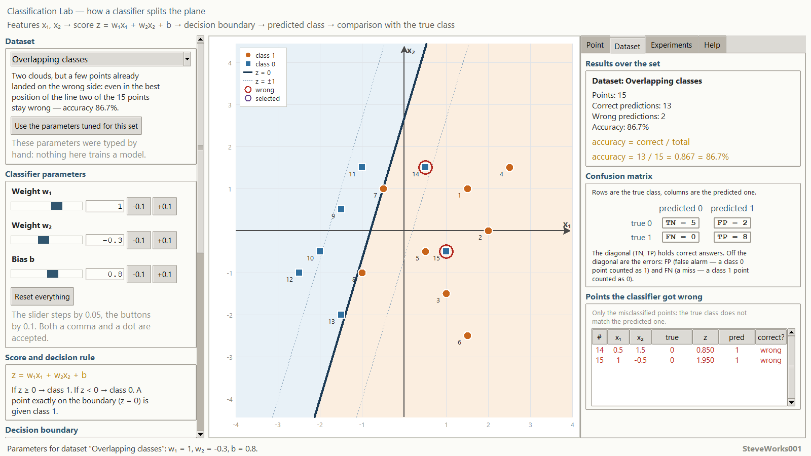
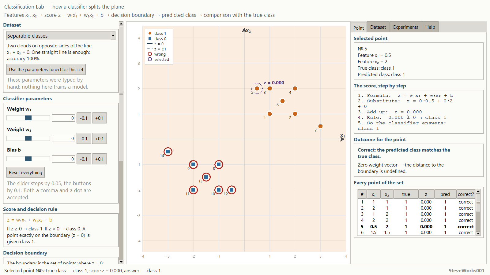
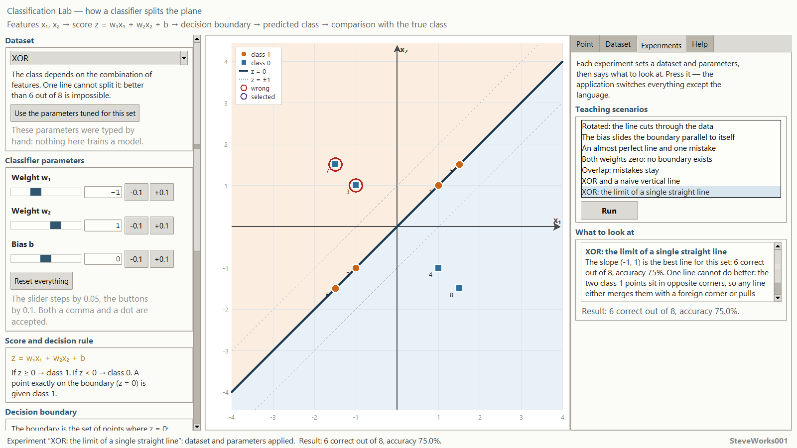
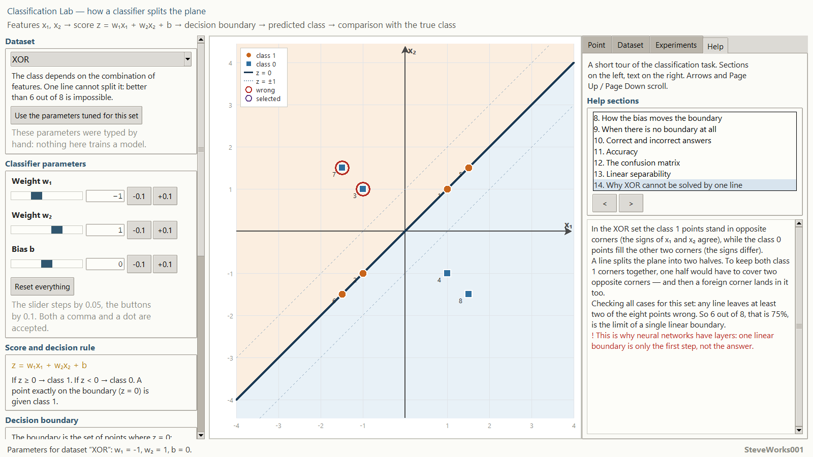
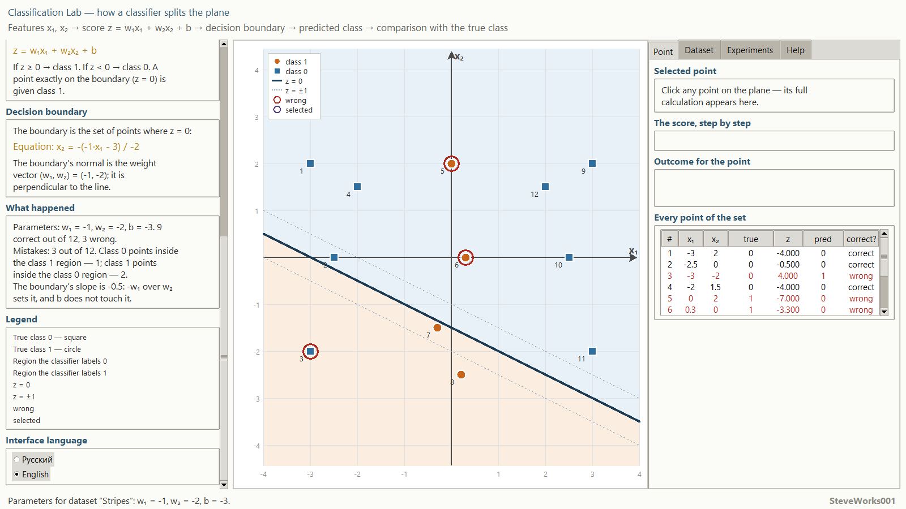
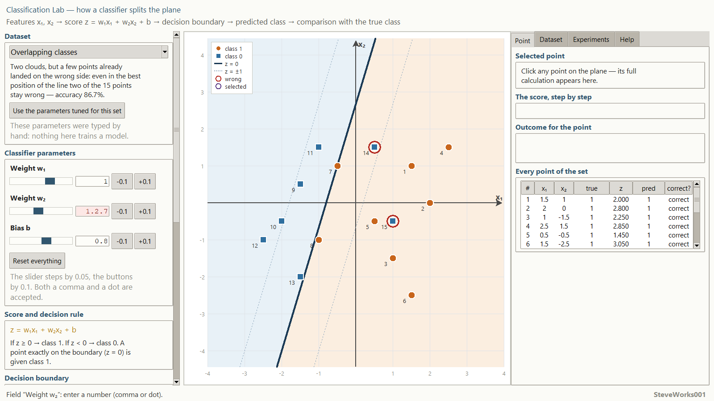

# Classification Lab — an educational simulator of the classification task

Project 9 of 13 in the educational neural-network simulator series.
A single-file Python and Tkinter application: standard library only, no external
packages, no network and no dependency installation.
It explains the classification task itself — how two features become a class and
what the decision boundary does along the way. This is not a neural network
training system.

Russian version: [README_RU.md](README_RU.md).

---

## Purpose

The simulator answers one question: **how does a straight line on the plane split
points into two classes, and what happens when one straight line cannot do it**.
Changing the two weights and the bias shows, in real time, the numeric score of
every point, the sign and magnitude of that score, the distance from the point to
the boundary, the predicted class, and whether it matches the true one.

The main chain the whole interface is built on:

**features `x₁, x₂` → score `z` → decision boundary → predicted class →
comparison with the true class → mistakes and accuracy**

There is a single model everywhere: the boundary, the shaded half-planes, the
predictions, the confusion matrix and the accuracy are all computed from the same
`w₁`, `w₂` and `b`. No decorative lines and no pre-cooked answers.

### What this project does not contain

The neighbouring project in the series, Neural Network Training Lab, shows the
full training loop. There is no training here, on purpose:

- no epochs, no gradient descent, no backpropagation;
- no loss function and no optimizer — you change the parameters yourself;
- no neural network, no hidden layers, no nonlinear activations;
- no large datasets: the sets are small and hand-authored;
- no production features of machine-learning libraries.

All the attention goes to one step: how a pair of features becomes a class, and
why a straight line sometimes simply cannot give the right answer.

## Learning goals

- Understand that classification outputs a label, not a number, and how a label
  differs from a score.
- Walk the whole chain: features → score → rule → class → checking the answer.
- Understand that the score `z` is first just a number, and the class only appears
  after the threshold.
- Understand why the decision boundary is the ordinary line
  `w₁x₁ + w₂x₂ + b = 0`, and how the weight vector sets its direction.
- Feel the difference between the weights and the bias: rotation versus a
  parallel shift.
- Understand that `|z| / ‖w‖` is the distance from a point to the boundary and the
  sign of `z` is the side the point lies on.
- Learn to tell "few mistakes" apart from "the right line": accuracy is one number
  for the whole set.
- Read a 2×2 confusion matrix and see that it can never disagree with accuracy.
- Understand linear separability and honestly admit that some problems are not
  solvable by one straight line.
- Understand why XOR, the ring and the stripes are limits of the linear model
  rather than badly chosen settings.

## Mathematics: a linear binary classifier

| Concept | Notation |
|---|---|
| **Score** | `z = w₁·x₁ + w₂·x₂ + b` |
| **Decision rule** | `z ≥ 0 → class 1`, `z < 0 → class 0` |
| **Decision boundary** | `w₁·x₁ + w₂·x₂ + b = 0` |
| **Confidence contours** | `w₁·x₁ + w₂·x₂ + b = +1` and `= −1` |
| **Distance to the boundary** | `\|z\| / √(w₁² + w₂²)` |
| **Accuracy** | `correct predictions / all predictions` |

**Score.** The classifier computes a number before it computes a class. The
substitution is shown step by step: formula → values → terms → sum → rule →
answer. The sign of `z` says which side of the boundary the point lies on, and
`|z| / ‖w‖` says how far. When `z = 0` the point stands exactly on the boundary.

**Decision rule.** The threshold is chosen deliberately and is the same for every
point. A point exactly on the boundary (`z = 0`) receives class 1 — a dedicated
experiment shows that instead of hiding it in the wording.

**Decision boundary.** This is the set of points with `z = 0`, that is, an
ordinary line taken from the very same `w₁`, `w₂` and `b` that produce the score.
The vector `(w₁, w₂)` is perpendicular to the line and points in the direction
where the score grows: on one side of the line class 1 is predicted, on the other
side class 0.

**How the weights and the bias move the line.** `w₁` and `w₂` set the tilt: the
ratio of the weights fixes the direction of the normal. `b` does not rotate the
line, it slides it parallel to itself. With `w₁ = 0` and `w₂ = 0` the score equals
`b` everywhere, so there is nothing to split the plane with: there is no boundary,
and the whole plane belongs to one class. The application shows this honestly —
the line is simply not drawn.

**The `z = ±1` contours.** Two dashed lines on either side of the boundary mark
the band where the decision is "not confident": the further a point is from the
boundary, the harder a small parameter change is to push it to the other side.

**Metrics.** Accuracy is the share of correct answers. The 2×2 confusion matrix
spreads the same result out: rows are the true class, columns the predicted one.
`TN` and `TP` form the diagonal, that is the correct answers; `FP` (true `0`,
predicted `1`) is a false alarm; `FN` (true `1`, predicted `0`) is a miss.
`TN + TP` always equals the number of correct answers and `FP + FN` the number of
mistakes, so the matrix and accuracy cannot diverge. Precision, recall, F1, ROC
and AUC are out of scope here.

**Linear separability.** A set is linearly separable if there is a line such that
only class `0` points lie on one side and only class `1` points on the other. Such
a line does not exist for every set: the "Ring" needs a closed region and the
"Stripes" need two disconnected ones, while one line can give a class only one
half-plane. The application never passes a wish off as a possibility: on
non-separable sets the mistakes stay, and that is the main lesson.

## Hand-authored datasets

Every point coordinate is written by hand, so a set never changes between launches
and every point stays visible. No random noise.

| Dataset | Points | Meaning |
|---|---|---|
| **Separable classes** | 14 | Two clouds on opposite sides of a line: one line is enough, no mistakes. |
| **Overlapping classes** | 15 | Some points of one class already sit in the other region: however you turn the line, mistakes remain. |
| **XOR** | 8 | The class depends on the combination of both feature signs: the classic case where a linear model is powerless in principle. |
| **Ring** | 13 | Class `0` in the centre, class `1` around it: the line would have to close a region, and it cannot. |
| **Stripes** | 12 | Class `0` takes two disconnected bands at the edges, class `1` fills the middle one. |

Each dataset carries three fixed values of `w₁`, `w₂` and `b` in the source (the
`tuned` field of the `DATASETS` dictionary). The "Use the parameters tuned for
this set" button only inserts them: the application runs neither a search nor any
training. Under the application's own rules those triples give `14 / 14`,
`13 / 15`, `6 / 8`, `9 / 13` and `9 / 12` correct predictions.

So that "best" is not an unsupported promise, all five triples were checked
against a search that scores lines with the very same `evaluate` function: every
direction of the line and every offset, both inside the interface ranges
(`w₁, w₂ ∈ −3…3` at step 0.05, `b ∈ −4…4`) and without any range limit. Nothing
scored better on any of the five sets. The search itself does not run inside the
application — the button types in stored numbers, and the choice of those numbers
stayed with a person.

## Interface and how to use it

- **On the left** — the dataset chooser and the three classifier parameters
  (`w₁`, `w₂`, `b`), each with a slider, an entry field and `-0.1` and `+0.1` step
  buttons; the weights range over `−3…3` and the bias over `−4…4`. The same column
  holds the "Use the parameters tuned for this set" and "Reset everything"
  buttons, the "Score and decision rule" block, the equation of the current
  boundary, the "What happened" panel, the legend and the language switch.
- **In the centre** — the classification plane: shaded half-planes, the decision
  boundary, the dashed `z = ±1` contours and every point of the set. The marker
  shape encodes the true class, the colour of the region it sits in encodes the
  predicted class, a red ring marks a mistake and a frame marks the selected
  point.
- **On the right** — four tabs: "Point", "Dataset", "Experiments" and "Help".
- The "Point" tab holds the full analysis of the selected point: coordinates, true
  class, the substitution into the formula, the score `z`, the side and the
  distance to the boundary, the rule, the predicted class and the verdict
  "correct / wrong". Below it, the table of all points with the columns
  `№`, `x₁`, `x₂`, `true`, `z`, `pred`, `correct?`.
- The "Dataset" tab shows the number of correct answers and of mistakes, accuracy
  with an explicit substitution (for example `accuracy = 13 / 15 = 0.867 = 86.7%`),
  the 2×2 confusion matrix and a separate list of the points where the classifier
  was wrong; when there are no mistakes, the panel explains why the list is empty.
- A point can be selected by clicking it on the plane or by picking its row in the
  table — both lead to the same point.
- The usual sequence: pick a set → drag `w₁`, `w₂` and `b` → watch the boundary
  move and see which points cross to the other side → open "Point" for the
  breakdown and "Dataset" for the cost of the mistakes over the whole set.
- Keyboard input accepts both a dot and a comma as the decimal separator, and
  negative values. Invalid input never crashes the app: the field is highlighted,
  a clear message appears in the status bar, and the previous valid value is kept.
  An out-of-range value is not dropped silently — the message names the field's
  range and the value that was used instead.

The interface is fully available in English and Russian and switches without a
restart; the current state — dataset, `w₁`, `w₂`, `b`, selected point, active tab
and chosen experiment — is preserved when the language changes.

## Built-in experiments

Ten scenarios, each of which sets a dataset and parameters and explains one
specific behaviour:

1. Perfectly separable classes;
2. Rotated: the line cuts through the data;
3. The bias slides the boundary parallel to itself;
4. An almost perfect line and one mistake;
5. Both weights zero: no boundary exists;
6. Overlap: mistakes stay;
7. XOR and a naive vertical line;
8. XOR: the limit of a single straight line;
9. Ring: a line cannot encircle a class;
10. Stripes: two regions do not fit one line.

The panel states the goal of the experiment and what to look at — for instance,
why there is still a mistake at `92.9%`, and why one line genuinely cannot do
better on XOR.

## Help

Fourteen short sections: the classification task, features and labels, binary
classification, what the score means, the decision rule, the decision boundary,
how the weights and how the bias move the boundary, when there is no boundary at
all, correct and incorrect answers, accuracy, the confusion matrix, linear
separability, and why XOR cannot be solved by one line. Formulas appear where they
are unavoidable; a full textbook is not embedded into the application.

## Guided experiments

Five experiments made of actions this interface really allows, with the numbers the
application prints for them. Any of them can be started again with
"Reset everything".

**1. Rotation against a shift.** Change: press "Reset everything" — it returns the
"Separable classes" dataset and the parameters `w₁ = 1`, `w₂ = 1`, `b = 0`. Press
`-0.1` under `w₂` once (it becomes `0.9`), then type `-1` in the same field.
Observe: at `w₂ = 0.9` the "Dataset" tab still reads `14 / 14 = 1.000 = 100.0%`,
while at `w₂ = -1` it reads `7 / 14 = 0.500 = 50.0%` with `TN = 2`, `FP = 5`,
`FN = 2`, `TP = 5`. The boundary equation changes from `x₂ = -(1·x₁ + 0) / 1` to
`x₂ = -(1·x₁ + 0) / -1`: the line turns instead of sliding. Six rows of "Every
point of the set" show `z = 0.000`; three of them are true class `0` (№8, №11, №13)
and the rule `z ≥ 0` hands them to class `1`, while the three class `1` points
(№1, №4, №6) stay correct.
Think about: why a small weight step cost not a single correct answer while a
ninety-degree turn cost half the set, and how many mistakes in that position are
created by the `z = 0` convention itself.

**2. A shift without rotation.** Change: put `w₂` back to `1` and set `b = 2.5` —
through the entry field or with 25 presses of `+0.1`.
Observe: `12 / 14 = 0.857 = 85.7%`; the normal is still `(1, 1)` and the equation
reads `x₂ = -(1·x₁ + 2.5) / 1`, so the line moved parallel to itself. There are two
mistakes: №8 (-1, -1) with `z = 0.500` and №12 (-0.5, -2) with `z = 0.000`, whose
distance to the boundary is `0.000`. Now set `b = -2.5`:
`13 / 14 = 0.929 = 92.9%` with a single mistake at №1 (1, 1), whose `z = -0.500`
and distance `0.354`.
Think about: at `92.9%` almost the whole set is right and one point is still wrong —
why accuracy says nothing about which point it is, and where the "Dataset" tab
lists it by name.

**3. Zero weights.** Change: on the same dataset set `w₁ = 0` and `w₂ = 0` with
`b = 0`.
Observe: no line is drawn, the whole canvas is one colour, the "Decision boundary"
block on the left explains that any line could serve and the score equals `b`
everywhere. If a point is clicked, "The score, step by step" gives `z = 0.000` and,
where the distance belongs, the line "Zero weight vector — the distance to the
boundary is undefined". The result is `7 / 14 = 0.500 = 50.0%`. The same zeros on the other sets
give `8 / 15 = 53.3%`, `4 / 8 = 50.0%`, `8 / 13 = 61.5%` and `4 / 12 = 33.3%`, and
on "Stripes" with `b = -2` the result becomes `8 / 12 = 66.7%`: now the whole plane
belongs to class `0`.
Think about: why the score always equals the share of the points of whichever class
the rule picks, and how this case differs from a badly drawn line.

**4. XOR: the boundary stands on the points.** Change: pick the "XOR" dataset and
press "Use the parameters tuned for this set" — that is `w₁ = -1`, `w₂ = 1`,
`b = 0`.
Observe: `6 / 8 = 0.750 = 75.0%`, and all four class `1` rows show `z = 0.000` —
they lie exactly on the boundary and keep their class only because of the rule
`z ≥ 0`. The mistakes are №3 (-1, 1) and №7 (-1.5, 1.5), at distances `1.414` and
`2.121`. One press of `-0.1` on `b` drops the result to `2 / 8 = 0.250 = 25.0%`;
one press of `+0.1` leaves `75.0%`.
Think about: why the vertical line `w₁ = 1`, `w₂ = 0` gives exactly
`4 / 8 = 50.0%`, and whether `75.0%` here is the model's merit or the merit of the
`z = 0` convention.

**5. Ring and Stripes: the ceiling of one line.** Change: press "Use the parameters
tuned for this set" on "Ring", then on "Stripes", and afterwards drag all three
sliders across their whole range.
Observe: "Ring" stops at `9 / 13 = 0.692 = 69.2%` — with the tuned parameters the
four mistakes are exactly the outer class `1` points №7, №9, №11 and №13; "Stripes" stops at
`9 / 12 = 0.750 = 75.0%`, losing №3 from the left band and №5 and №6 from the
middle one. No position of the sliders inside `-3…3` and `-4…4` does better, and
neither does a search over every direction with every offset.
Think about: what shape of region one line can hand to a class at all, and what
model would be needed instead.

## Installation and launch

The application is a single file; there is nothing to build or install.

Windows:

```bash
python classification_lab.py
```

macOS and Linux:

```bash
python3 classification_lab.py
```

No command-line arguments, external data or settings files are needed: the point
sets, the parameters and every interface string live inside the file. Quick start:
the application opens on the "Separable classes" dataset with `w₁ = 1`, `w₂ = 1`,
`b = 0`, and the "Point" tab shows nothing but an invitation to click a point.
Click one: "The score, step by step" prints the substitution and `z`, and "Outcome
for the point" gives the verdict. Then open "Experiments", press "Run" next to
"Overlap: mistakes stay" and read `Result: 13 correct out of 15, accuracy 86.7%.` in
the status bar; the same two mistakes are listed on the "Dataset" tab.

The window opens at about `1280×800` or larger (on a typical screen roughly 90 % of
the width and 88 % of the height) and does not shrink below about `1260×740`; on a
short display that lower bound becomes the screen height minus a margin. The
application asks the window manager to maximise the window, which some window
managers refuse — resize it by hand in that case. Very narrow windows make the
interface harder to read.

## Screenshots

The frames come from the running application; the captured area is the client
part of the window, 1600x900 pixels, with no window border or title bar. The
starting window size depends on the screen, so on another monitor the frame is
simply at a different scale: the size changes, the content does not. All eight
frames were captured at the same geometry.

**Separable classes with `w₁ = 1`, `w₂ = 1`, `b = 0`; point №12 is selected**



**Overlapping classes in the tuned position; point №14 sits in the wrong region**



**The Dataset tab: metrics of the set and the confusion matrix**



**Both weights and the bias are zero: there is no boundary, and the whole set is called class 1**



**The Experiments tab: "XOR: the limit of a single straight line" has been run**



**The Help tab: section 14 "Why XOR cannot be solved by one line"**



**The left column scrolled to its end: "What happened", the legend and the language switch**



**Invalid input: the weight `w₂` field contains `1.2.7`**



## Requirements

- Python 3.8 or newer.
- Tkinter — included in the official Python builds for Windows and macOS; on some
  Linux distributions it is a separate `python3-tk` package.
- Standard library only: `math`, `tkinter`, `tkinter.ttk`,
  `tkinter.font`.
- Not used: NumPy, pandas, SciPy, matplotlib, scikit-learn and third-party GUI
  frameworks.
- No network connection is required to run the application.

## Limitations

- The application **does not train** anything: no gradient descent, no loss
  function, no backpropagation, no parameter updates.
- The model is one straight line over two features: no hidden layers, no
  nonlinearity, no multi-class classification.
- There are exactly two features, which is why the problem fits on a plane.
- A point with `z = 0` is assigned class `1` by the rule; that is a chosen
  convention, not a property of the data.
- The datasets are small and hand-authored: they show the geometry of the task,
  not the statistics of a real sample.
- The parameter ranges are fixed (`w₁, w₂ ∈ −3…3`, `b ∈ −4…4`) — enough for every
  teaching line used here.
- "Use the parameters tuned for this set" inserts stored hand-picked values and
  searches nothing at the moment of the click; the exhaustive check was done
  outside the application.
- The confusion matrix and accuracy are computed over the whole set: there is no
  train/test split here.

## Educational note

The simulator is meant to build an intuition for how a linear classifier splits
the feature space and where its abilities end. Some conventions are chosen for
clarity and may differ from those of a particular machine-learning library — for
example, the rule for `z = 0` and the way accuracy is written. Transfer them into a
real model deliberately.

## What to know beforehand

**Required:** Python 3 with Tkinter and running one file from a command line. No
`pip` packages, no network, no external data and no settings files.

**Mathematics:** substituting numbers into `w₁x₁ + w₂x₂ + b` and knowing what the
distance from a point to a line means. Derivatives and matrix algebra are not used:
the confusion matrix here is a table of four counters, and the application writes
accuracy out with its numbers shown.

**Helpful but not required:** project 1 "One Artificial Neuron", where the same
number `z` first appears; project 8 "Loss Functions", where a score is turned into a
penalty but not into a class label; project 13 "Multiclass Softmax", where the class
is the largest of several scores rather than the result of a threshold at zero.
None of them has to be completed before opening this application.

**About the Python version:** the "Requirements" section names Python 3.8 or newer.
The application does not check the version and no other versions were tested — that
is declared compatibility, not a verified guarantee.

## Place in the series

Project 9 of 13. The order is not strict: every project runs on its own and reads
nothing from its neighbours. Only the links that exist by content are listed below.

| Project | Link by content |
|---|---|
| 1 — One Artificial Neuron | there `z = w₁x₁ + w₂x₂ + b` becomes the answer of a neuron; here the same number cuts the plane in half |
| 2 — Perceptron | there the sign of this sum becomes a training step; here a person moves the parameters and nothing updates |
| 4 — Gradient Descent | there a line would be searched for through a loss function; here there is neither loss nor search |
| 7 — Activation Functions | there a sigmoid turns `z` into a probability; here `z` stays a number and the threshold runs through zero |
| 8 — Loss Functions | there a wrong answer is charged a penalty; here the same score produces a class label without one |
| 10 — Overfitting | there the mean squared error is read separately on train and on test; here the set is single and the metrics cover all of it |
| 13 — Multiclass Softmax | here two classes and one threshold; there the class is the largest of several scores |

## Developer

**Developer: SteveWorks001**

## License

This project is released under the MIT license; the full text is in the file
[LICENSE](LICENSE).
