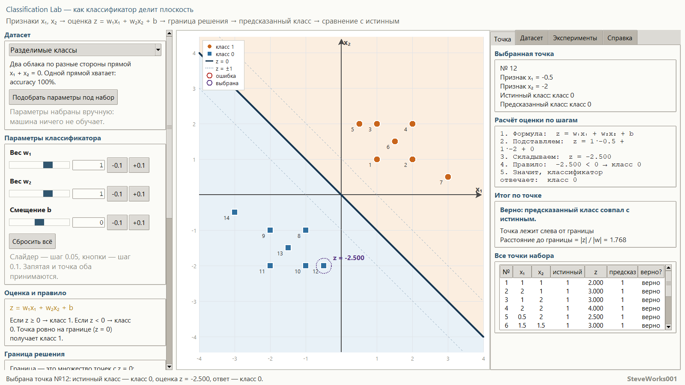
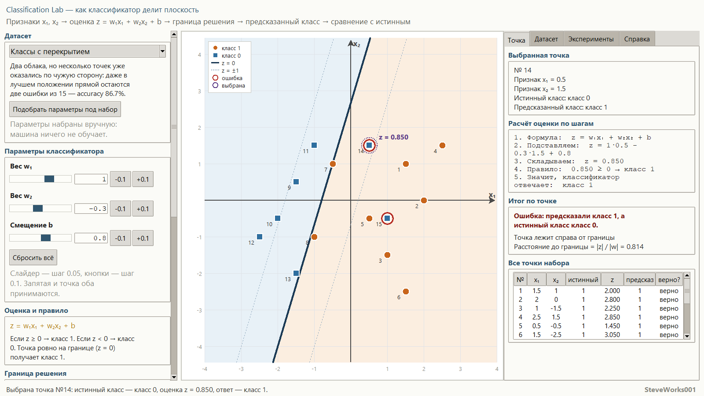
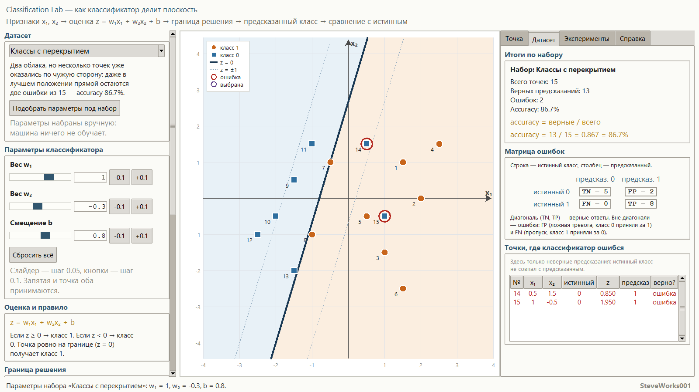
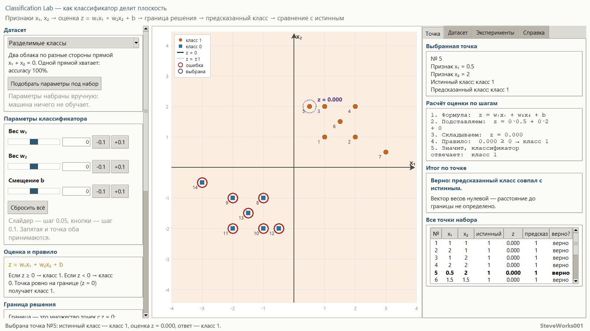
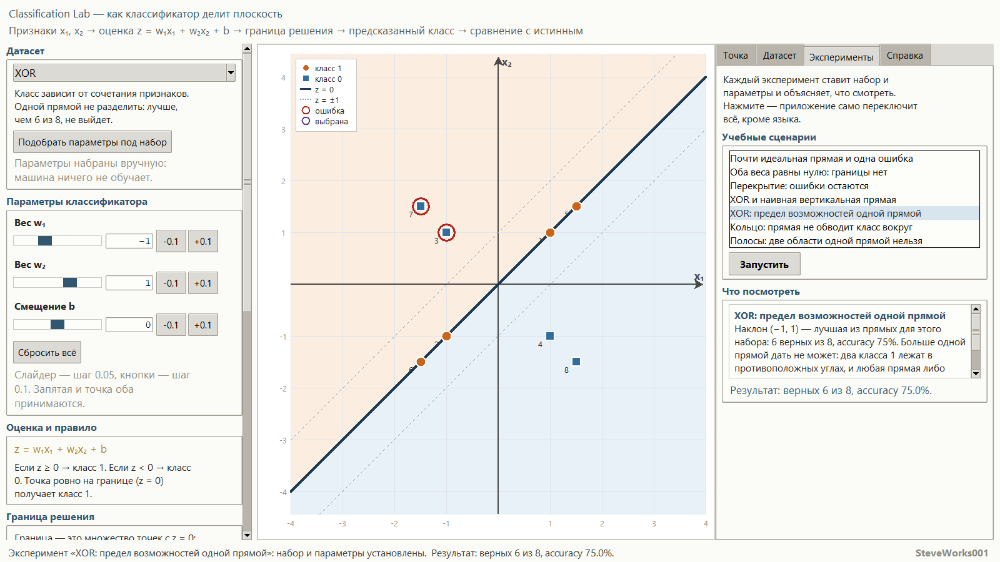
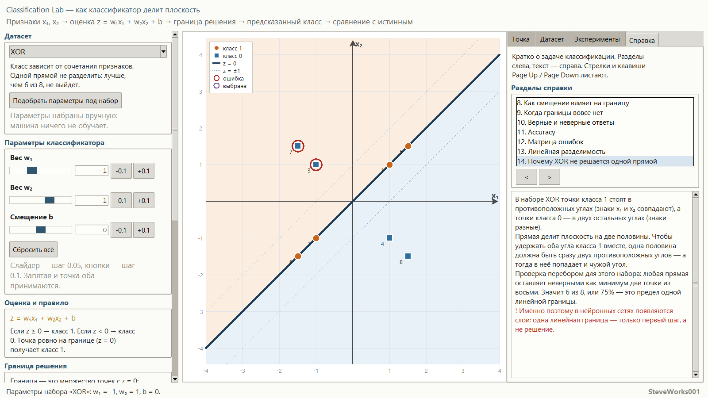
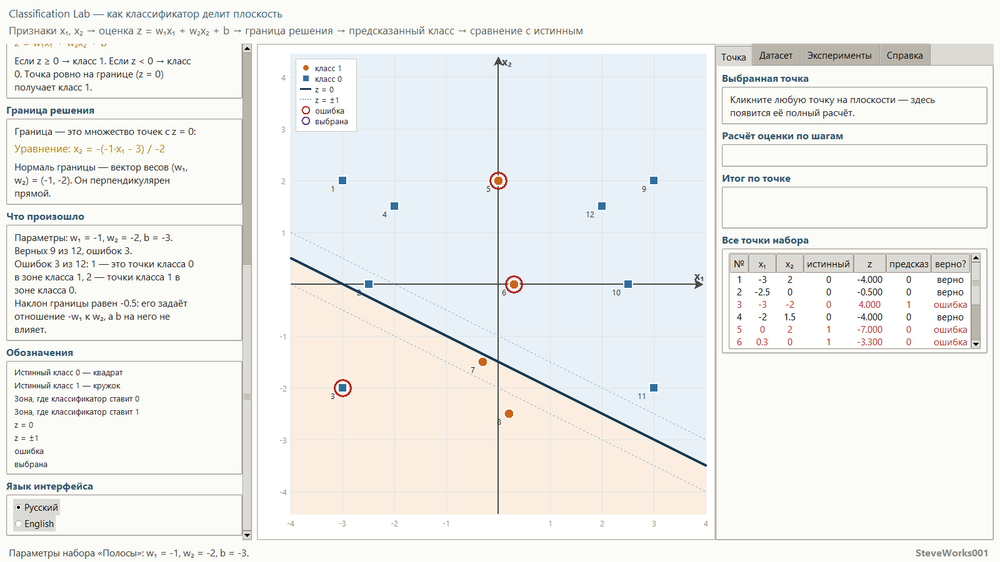
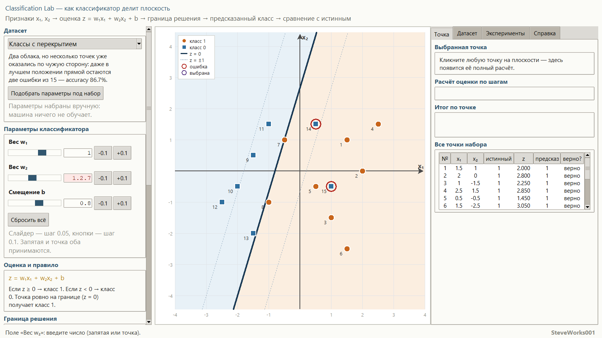

# Classification Lab — учебный симулятор задачи классификации

Проект 9 из 13 серии учебных симуляторов нейронных сетей.
Однофайловое приложение на Python и Tkinter: только стандартная библиотека,
без внешних пакетов, без сети и без установки зависимостей.
Разбирается сама задача классификации — как из двух признаков получается класс и
что при этом делает граница решения. Это не система обучения нейросетей.

Текст на английском: [README_EN.md](README_EN.md).

---

## Назначение

Симулятор отвечает на один вопрос: **как прямая на плоскости делит точки на два
класса и что происходит, когда делить одной прямой нельзя**. Меняя два веса и
смещение, вы в реальном времени видите числовую оценку каждой точки, знак и
величину этой оценки, расстояние от точки до границы, предсказанный класс и то,
совпал ли он с истинным.

Основная цепочка, на которой построен весь интерфейс:

**признаки `x₁, x₂` → оценка `z` → граница решения → предсказанный класс →
сравнение с истинным классом → ошибки и accuracy**

Модель одна и та же везде: граница, зоны, предсказания, матрица ошибок и accuracy
считаются по одним и тем же `w₁`, `w₂` и `b`. Никаких декоративных линий и никаких
заранее заготовленных ответов.

### Чего в этом проекте нет

Соседний проект серии, Neural Network Training Lab, показывает полный цикл
обучения. Здесь обучения нет намеренно:

- нет эпох, градиентного спуска и обратного распространения ошибки;
- нет функции потерь и оптимизатора — параметры меняете вы сами;
- нет нейросети, скрытых слоёв и нелинейных активаций;
- нет больших выборок: наборы маленькие и учебные;
- нет производственных возможностей библиотек машинного обучения.

Всё внимание — одному шагу: как из пары признаков получается класс и почему
прямая иногда не может дать правильный ответ.

## Учебные цели

- Понять, что классификация выдаёт метку, а не число, и чем метка отличается от
  оценки.
- Пройти цепочку целиком: признаки → оценка → правило → класс → проверка ответа.
- Понять, что оценка `z` — это сначала просто число, а класс появляется только
  после порога.
- Понять, почему граница решения — это обычная прямая `w₁x₁ + w₂x₂ + b = 0`, и как
  вектор весов задаёт её направление.
- Почувствовать разницу между весами и смещением: поворот против параллельного
  сдвига.
- Понять, что величина `|z| / ‖w‖` — расстояние от точки до границы, а знак `z` —
  сторона, на которой точка лежит.
- Научиться видеть разницу между «мало ошибок» и «правильная прямая»: accuracy —
  одно число на весь набор.
- Читать матрицу ошибок 2×2 и понимать, что она никогда не расходится с accuracy.
- Понять линейную разделимость и честно признать, что часть задач одной прямой не
  решается.
- Понять, почему XOR, кольцо и полосы — именно пределы возможностей линейной
  модели, а не неудачные настройки.

## Математика: линейный бинарный классификатор

| Понятие | Запись |
|---|---|
| **Оценка** | `z = w₁·x₁ + w₂·x₂ + b` |
| **Правило решения** | `z ≥ 0 → класс 1`, `z < 0 → класс 0` |
| **Граница решения** | `w₁·x₁ + w₂·x₂ + b = 0` |
| **Изолинии уверенности** | `w₁·x₁ + w₂·x₂ + b = +1` и `= −1` |
| **Расстояние до границы** | `\|z\| / √(w₁² + w₂²)` |
| **Accuracy** | `верные предсказания / все предсказания` |

**Оценка.** Классификатор сначала считает не класс, а число. Подстановка
показывается по шагам: формула → значения → слагаемые → сумма → правило → ответ.
Знак `z` говорит, на какой стороне границы лежит точка, а `|z| / ‖w‖` — насколько
далеко. При `z = 0` точка стоит ровно на границе.

**Правило решения.** Порог выбран сознательно и одинаков для всех точек. Точка
ровно на границе (`z = 0`) получает класс 1 — это видно на конкретном учебном
эксперименте, а не спрятано в формулировке.

**Граница решения.** Это множество точек с `z = 0`, то есть обычная прямая,
взята она из тех же `w₁`, `w₂` и `b`, что и оценка. Вектор `(w₁, w₂)` перпендикулярен
прямой и показывает, в какую сторону растёт оценка: по одну сторону от прямой
предсказывается класс 1, по другую — класс 0.

**Как веса и смещение двигают прямую.** `w₁` и `w₂` задают наклон: отношение весов
определяет направление нормали. `b` не поворачивает прямую, а сдвигает её
параллельно самой себе. При `w₁ = 0` и `w₂ = 0` оценка везде равна `b`: делить
плоскость не на чем, границы нет, и вся плоскость относится к одному классу.
Приложение показывает это честно — прямая просто не нарисована.

**Изолинии `z = ±1`.** Пунктирные прямые по обе стороны от границы показывают
полосу, внутри которой решение «неуверенное»: точка дальше от границы — значит
её проще перенести на чужую сторону небольшим изменением параметров.

**Метрики.** `accuracy` — доля верных ответов. Матрица ошибок 2×2 раскладывает тот
же результат по сторонам: строки — истинный класс, столбцы — предсказанный.
`TN` и `TP` — диагональ, то есть верные ответы; `FP` (истинный `0`, предсказан `1`) —
ложная тревога; `FN` (истинный `1`, предсказан `0`) — пропуск. `TN + TP` всегда даёт
число верных, `FP + FN` — число ошибок, поэтому матрица и accuracy не могут
расойтись. Precision, recall, F1, ROC и AUC здесь не рассматриваются.

**Линейная разделимость.** Набор линейно разделим, если существует прямая, по одну
сторону которой лежат только точки класса `0`, а по другую — только класса `1`.
Такая прямая существует не для каждого набора: «Кольцо» требует замкнутой области,
«Полосы» — двух несвязных, а одна прямая умеет отдать классу только одну
полуплоскость. Приложение не выдаёт желаемое за возможное: на неразделимых наборах
ошибки остаются, и это главный учебный вывод.

## Учебные наборы данных

Координаты каждой точки выбраны вручную, поэтому набор не меняется между
запусками, и каждую точку видно отдельно. Никакого случайного шума.

| Набор | Точек | Смысл |
|---|---|---|
| **Разделимые классы** | 14 | Два облака по разные стороны прямой: одной прямой хватает, ошибок нет. |
| **Классы с перекрытием** | 15 | Часть точек одного класса лежит в чужой области: сколько ни крути прямую, ошибки останутся. |
| **XOR** | 8 | Класс зависит от сочетания знаков обоих признаков: классический пример, где линейная модель принципиально бессильна. |
| **Кольцо** | 13 | Класс `0` в центре, класс `1` вокруг: прямой нужно замкнуть область, а она не умеет. |
| **Полосы** | 12 | Класс `0` занимает две несвязные полосы по краям, класс `1` — среднюю. |

Для каждого набора в исходнике лежат три фиксированных значения `w₁`, `w₂` и `b`
(поле `tuned` в словаре `DATASETS`). Кнопка «Подобрать параметры под набор» просто
их подставляет: ни поиска, ни обучения в приложении нет. Что эти значения дают по
правилам самого приложения: `14 / 14`, `13 / 15`, `6 / 8`, `9 / 13` и `9 / 12`
верных ответов.

Чтобы слово «лучшее» не оставалось обещанием на словах, все пять троек проверены
перебором, который считает верные ответы той же функцией `evaluate`: перебраны все
направления прямой и все смещения — и в диапазонах интерфейса
(`w₁, w₂ ∈ −3…3` с шагом 0.05, `b ∈ −4…4`), и без ограничения по диапазону. Ни на
одном наборе лучше не получилось. Сам перебор в приложении не запускается: кнопка
только подставляет сохранённые числа, и выбор этих чисел остался за человеком.

## Интерфейс и как пользоваться

- **Слева** — выбор набора, три параметра классификатора (`w₁`, `w₂`, `b`): ползунок,
  поле ввода и кнопки шага `-0.1` и `+0.1` для каждого; веса доступны в диапазоне
  `−3…3`, смещение — `−4…4`. Там же кнопки «Подобрать параметры под набор» и
  «Сбросить всё», блок «Оценка и правило», подпись текущей границы, панель
  «Что произошло», обозначения и переключатель языка.
- **В центре** — плоскость классификации: закрашенные полуплоскости, граница
  решения, пунктирные изолинии `z = ±1`, все точки набора. Форма маркера задаёт
  истинный класс, цвет зоны — предсказанный, красное кольцо — ошибку, рамка —
  выбранную точку.
- **Справа** — четыре вкладки: «Точка», «Датасет», «Эксперименты», «Справка».
- На вкладке «Точка» — полный разбор выбранной точки: координаты, истинный класс,
  подстановка в формулу, оценка `z`, сторона и расстояние до границы, правило,
  предсказанный класс и вердикт «верно / ошибка». Там же таблица всех точек набора
  с колонками `№`, `x₁`, `x₂`, `истинный`, `z`, `предсказ.`, `верно?`.
- На вкладке «Датасет» — число верных и ошибок, accuracy с явной подстановкой
  (например, `13 / 15 = 0.867 = 86.7%`), матрица ошибок 2×2 и отдельный список
  точек, где классификатор ошибся; если ошибок нет, вместо списка показывается
  почему он пуст.
- Точку можно выбрать кликом на плоскости или строкой в таблице — оба способа
  ведут одну и ту же точку.
- Обычная последовательность: выбрать набор → двигать `w₁`, `w₂`, `b` → смотреть,
  как едет граница и какие точки переходят на чужую сторону → открыть «Точку»,
  чтобы увидеть разбор, и «Датасет», чтобы увидеть цену ошибки по всему набору.
- Ввод с клавиатуры принимает точку и запятую как разделитель, а также
  отрицательные значения. Некорректный ввод приложение не роняет: поле
  подсвечивается, в статусной строке появляется понятное сообщение, а предыдущее
  допустимое значение сохраняется. Значение вне диапазона не отбрасывается молча —
  показывается, какой диапазон у поля и какое значение взято вместо введённого.

Интерфейс полностью доступен на русском и английском и переключается без
перезапуска; текущее состояние — набор, `w₁`, `w₂`, `b`, выбранная точка, вкладка и
выбранный эксперимент — при переключении сохраняется.

## Готовые эксперименты

Десять сценариев, каждый меняет набор и параметры и объясняет одно конкретное
поведение:

1. Идеально разделимые классы;
2. Поворот: прямая прошла сквозь данные;
3. Смещение сдвигает границу параллельно;
4. Почти идеальная прямая и одна ошибка;
5. Оба веса равны нулю: границы нет;
6. Перекрытие: ошибки остаются;
7. XOR и наивная вертикальная прямая;
8. XOR: предел возможностей одной прямой;
9. Кольцо: прямая не обводит класс вокруг;
10. Полосы: две области одной прямой нельзя.

Панель показывает цель эксперимента и то, что в нём нужно увидеть, — например,
почему при `92.9%` всё ещё есть ошибка и почему на XOR лучше одной прямой дать
не может.

## Справка

Четырнадцать коротких разделов: задача классификации, признаки и метки, бинарная
классификация, что значит числовая оценка, правило решения, граница решения, как
веса и как смещение влияют на границу, когда границы вовсе нет, верные и неверные
ответы, accuracy, матрица ошибок, линейная разделимость и почему XOR не решается
одной прямой. Формулы приведены там, где без них не обойтись; полный учебник в
приложение не встраивается.

## Учебные опыты

Пять опытов состоят из действий, которые этот интерфейс действительно позволяет, и
из чисел, которые приложение печатает по этим действиям. Начать любой из них
заново можно кнопкой «Сбросить всё».

**1. Поворот против сдвига.** Действие: нажмите «Сбросить всё» — он возвращает
набор «Разделимые классы» и параметры `w₁ = 1`, `w₂ = 1`, `b = 0`. Один раз нажмите
`-0.1` под `w₂` (станет `0.9`), а затем в том же поле введите `-1`.
Наблюдайте: при `w₂ = 0.9` вкладка «Датасет» остаётся на `14 / 14 = 1.000 = 100.0%`,
а при `w₂ = -1` даёт `7 / 14 = 0.500 = 50.0%` с матрицей `TN = 2`, `FP = 5`,
`FN = 2`, `TP = 5`. Уравнение границы меняется с `x₂ = -(1·x₁ + 0) / 1` на
`x₂ = -(1·x₁ + 0) / -1` — прямая поворачивается, а не уезжает в сторону. В таблице
«Все точки набора» шесть строк дают `z = 0.000`; три из них — точки истинного
класса `0` (№8, №11, №13), и правило `z ≥ 0` отдаёт их классу `1`, а три точки
класса `1` (№1, №4, №6) остаются верными.
О чём подумать: почему маленький шаг веса не стоил ни одного верного ответа, а
поворот на девяносто градусов стоил половине набора, и сколько ошибок в этом
положении создано самим соглашением про `z = 0`.

**2. Смещение без поворота.** Действие: верните `w₂ = 1` и поставьте `b = 2.5` —
полем ввода либо 25 нажатиями `+0.1`.
Наблюдайте: `12 / 14 = 0.857 = 85.7%`, нормаль осталась `(1, 1)`, уравнение
`x₂ = -(1·x₁ + 2.5) / 1` — прямая сдвинулась параллельно себе. Ошибки две: №8
(-1, -1) с `z = 0.500` и №12 (-0.5, -2) с `z = 0.000`, у неё же расстояние до
границы `0.000`. Теперь поставьте `b = -2.5`: `13 / 14 = 0.929 = 92.9%`, единственная
ошибка — №1 (1, 1), её `z = -0.500` и расстояние `0.354`.
О чём подумать: при `92.9%` набор почти целый, но одна точка классифицирована
неверно — почему accuracy не говорит, какая именно точка, и где её имя видно
в списке ошибок на вкладке «Датасет».

**3. Нулевые веса.** Действие: на том же наборе поставьте `w₁ = 0` и `w₂ = 0`
при `b = 0`.
Наблюдайте: прямая не нарисована, вся плоскость одного цвета, блок «Граница
решения» слева объясняет, что границей может служить что угодно и оценка равна `b`
во всех точках. Если кликнуть любую точку, «Расчёт оценки по шагам» даст
`z = 0.000`, а вместо расстояния появится строка «Вектор весов нулевой —
расстояние до границы не определено». Итог —
`7 / 14 = 0.500 = 50.0%`. Те же нули на остальных наборах дают `8 / 15 = 53.3%`,
`4 / 8 = 50.0%`, `8 / 13 = 61.5%` и `4 / 12 = 33.3%`, а на «Полосах» при `b = -2`
получается `8 / 12 = 66.7%`: теперь вся плоскость относится к классу `0`.
О чём подумать: почему результат всегда равен доле точек того класса, который
выдаёт правило, и чем этот случай отличается от неудачно проведённой прямой.

**4. XOR: граница стоит ровно на точках.** Действие: выберите набор «XOR» и
нажмите «Подобрать параметры под набор» — это `w₁ = -1`, `w₂ = 1`, `b = 0`.
Наблюдайте: `6 / 8 = 0.750 = 75.0%`, причём у всех четырёх точек класса `1` в
таблице стоит `z = 0.000`: они лежат точно на границе и сохраняют свой класс
только по правилу `z ≥ 0`. Ошибки — №3 (-1, 1) и №7 (-1.5, 1.5), их расстояния до
границы `1.414` и `2.121`. Один шаг `-0.1` по `b` роняет результат до
`2 / 8 = 0.250 = 25.0%`, а шаг `+0.1` оставляет `75.0%`.
О чём подумать: почему вертикальная прямая `w₁ = 1`, `w₂ = 0` даёт ровно
`4 / 8 = 50.0%` и является ли `75.0%` заслугой модели — или заслугой соглашения
про `z = 0`.

**5. Кольцо и Полосы: предел одной прямой.** Действие: нажмите «Подобрать параметры
под набор» на «Кольце», затем на «Полосах», а после этого свободно поводите все три
ползунка по всему диапазону.
Наблюдайте: «Кольцо» останавливается на `9 / 13 = 0.692 = 69.2%` — при подобранных
параметрах ошибаются четыре внешние точки класса `1` (№7, №9, №11, №13); «Полосы» —
на `9 / 12 = 0.750 = 75.0%`, где теряются точка №3 из левой полосы и точки №5 и №6
из серединной. Ни одно положение ползунков в пределах `−3…3` и `−4…4` не даёт
лучше, и перебор всех направлений со всеми смещениями тоже.
О чём подумать: какую форму области одна прямая вообще может отдать классу и какая
модель понадобилась бы вместо неё.

## Установка и запуск

Приложение — один файл; сборки и установки зависимостей не требуется.

Windows:

```bash
python classification_lab.py
```

macOS и Linux:

```bash
python3 classification_lab.py
```

Аргументы командной строки, внешние данные и файлы настроек не нужны: наборы
точек, параметры и все тексты интерфейса лежат в самом файле. Быстрый старт:
приложение открывается на наборе «Разделимые классы» с `w₁ = 1`, `w₂ = 1`, `b = 0`,
а справа на вкладке «Точка» пока только предложение кликнуть. Кликните точку: в
блоке «Расчёт оценки по шагам» появятся подстановка и `z`, в «Итоге по точке» —
вердикт. Затем откройте «Эксперименты», нажмите «Запустить» у сценария
«Перекрытие: ошибки остаются» и прочитайте в статусной строке сообщение
`Результат: верных 13 из 15, accuracy 86.7%.`; те же две ошибки лежат списком на
вкладке «Датасет».

Окно открывается примерно от `1280×800` (на типичном экране — около 90 % ширины и
88 % высоты) и не уменьшается примерно ниже `1260×740`; на невысоком дисплее нижняя
граница автоматически меньше экрана. Приложение просит оконный менеджер развернуть
окно, но часть менеджеров отказывает — тогда размер задают вручную. Очень узкие
окна ухудшают читаемость интерфейса.

## Скриншоты

Снимки сделаны из работающего приложения; захвачена клиентская часть окна
размером 1600×900 пикселей, без рамки и заголовка окна. Стартовый размер окна
зависит от экрана, поэтому на другом мониторе кадр будет другого масштаба:
изменится размер, но не содержимое. Все восемь кадров сняты при одинаковой
геометрии.

**Разделимые классы при `w₁ = 1`, `w₂ = 1`, `b = 0`; выбрана точка №12**



**Классы с перекрытием в подобранном положении; точка №14 лежит в чужой зоне**



**Вкладка «Датасет»: метрики набора и матрица ошибок**



**Нулевые веса: границы нет, весь набор отнесён к классу 1**



**Вкладка «Эксперименты»: запущен сценарий «XOR: предел возможностей одной прямой»**



**Вкладка «Справка»: раздел 14 «Почему XOR не решается одной прямой»**



**Левая колонка прокручена до конца: «Что произошло», «Обозначения» и переключатель языка**



**Некорректный ввод: в поле веса `w₂` набрано `1.2.7`**



## Требования

- Python 3.8 или новее.
- Tkinter — входит в официальные сборки Python для Windows и macOS; в некоторых дистрибутивах
  Linux ставится отдельно как пакет `python3-tk`.
- Только стандартная библиотека: `math`, `tkinter`, `tkinter.ttk`,
  `tkinter.font`.
- Не используются: NumPy, pandas, SciPy, matplotlib, scikit-learn и сторонние
  GUI-фреймворки.
- Сетевое соединение для работы приложения не требуется.

## Ограничения

- Приложение **не обучает** модель: нет градиентного спуска, функции потерь,
  обратного распространения и обновлений параметров.
- Модель — одна прямая на двух признаках: ни скрытых слоёв, ни нелинейности, ни
  многоклассовой классификации.
- Признаков ровно два, и только поэтому задачу видно на плоскости.
- Точка с `z = 0` по правилу относится к классу `1`; это выбранное соглашение, а
  не свойство данных.
- Наборы маленькие и составлены вручную: они показывают геометрию задачи, а не
  статистику реальной выборки.
- Диапазоны параметров фиксированы (`w₁, w₂ ∈ −3…3`, `b ∈ −4…4`) — этого достаточно
  для всех учебных прямых.
- «Подобрать параметры под набор» подставляет сохранённые вручную значения и
  ничего не перебирает в момент нажатия; проверка перебором сделана вне приложения.
- Матрица ошибок и accuracy считаются по всему набору целиком: отдельного
  учебно-тестового разбиения здесь нет.

## Учебная оговорка

Симулятор предназначен для понимания того, как линейный классификатор делит
пространство признаков и где его возможности заканчиваются. Отдельные соглашения
выбраны ради наглядности и могут отличаться от принятых в конкретной библиотеке
машинного обучения, — например, правило для `z = 0` или форма записи accuracy.
Переносить эти соглашения в реальную модель нужно осознанно.

## Что нужно знать заранее

**Строго необходимо:** Python 3 с Tkinter и запуск одного файла из командной
строки. Пакеты из `pip`, сеть, внешние данные и файлы настроек не нужны.

**Математика:** умение подставить числа в `w₁x₁ + w₂x₂ + b` и понимание, что такое
расстояние от точки до прямой. Производные и матричная алгебра не используются:
матрица ошибок здесь — таблица из четырёх счётчиков, а accuracy приложение
расписывает с явной подстановкой.

**Полезно, но не обязательно:** проект 1 «Один искусственный нейрон» — там впервые
появляется то же число `z`; проект 8 «Функции потерь» — там из оценки делают штраф,
но не метку класса; проект 13 «Многоклассовый Softmax» — там класс выбирается
максимумом из нескольких оценок, а не порогом по нулю. Ни один из них не нужно
проходить заранее, чтобы открыть это приложение.

**О версии Python:** раздел «Требования» называет Python 3.8 или новее.
Приложение версию не проверяет, а запуск на других версиях не тестировался —
это объявленная совместимость, а не проверенная гарантия.

## Место в серии

Проект 9 из 13. Порядок не строгий: каждый проект запускается сам по себе и
ничего не читает из соседних. Ниже только те связи, которые есть по содержанию.

| Проект | Связь по содержанию |
|---|---|
| 1 — Один искусственный нейрон | там `z = w₁x₁ + w₂x₂ + b` становится ответом нейрона; здесь то же число делит плоскость пополам |
| 2 — Перцептрон | там знак этой суммы превращается в шаг обучения; здесь параметры двигает человек и ничего не обновляется |
| 4 — Gradient Descent | там прямую искали бы перебором по функции потерь; здесь нет ни потери, ни поиска |
| 7 — Activation Functions | там сигмоида переводит `z` в вероятность; здесь `z` остаётся числом и порогуется по нулю |
| 8 — Loss Functions | там за ответ платят штрафом; здесь то же `z` без штрафа даёт метку класса |
| 10 — Overfitting | там среднеквадратичную ошибку читают отдельно на обучении и на тесте; здесь набор один и метрики считаются по нему целиком |
| 13 — Multiclass Softmax | здесь ровно два класса и порог; там класс — максимум из нескольких оценок |

## Разработчик

**Разработчик: SteveWorks001**

## Лицензия

Проект распространяется под лицензией MIT; полный текст лежит в файле
[LICENSE](LICENSE).
